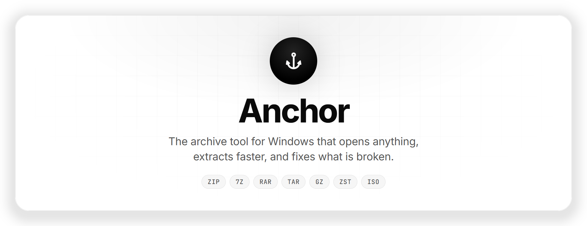
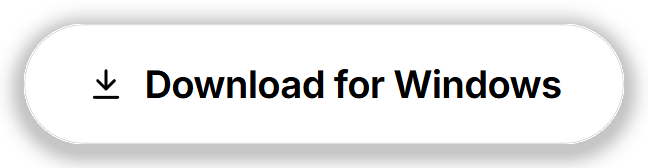
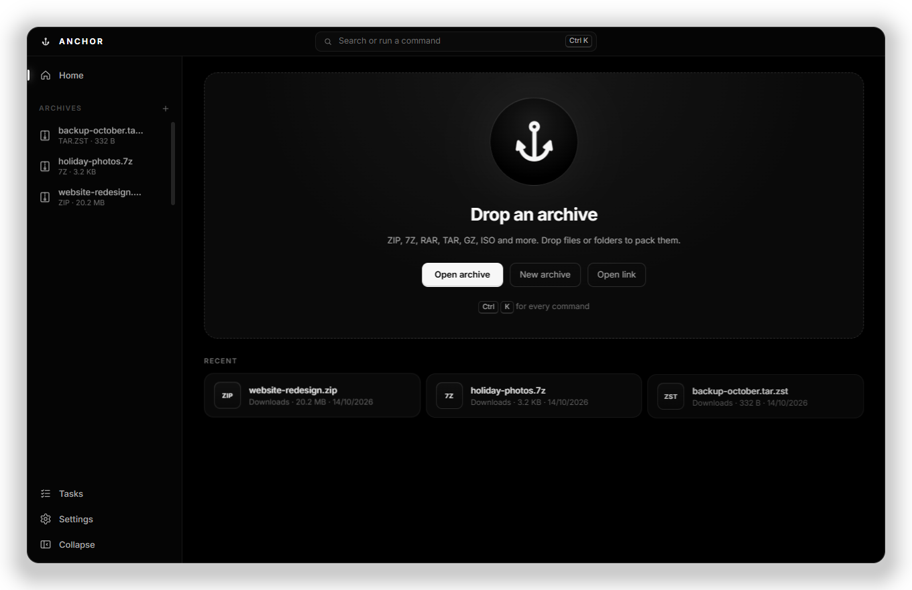
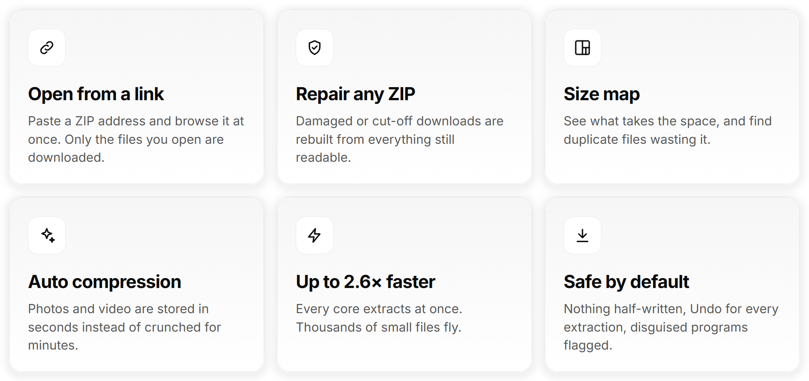
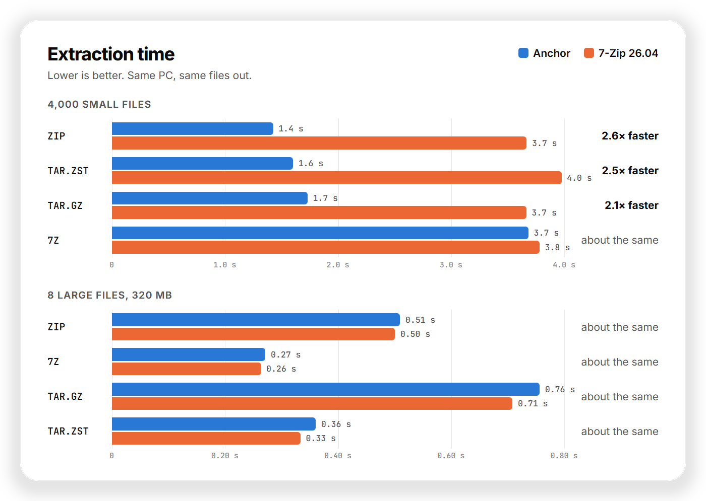
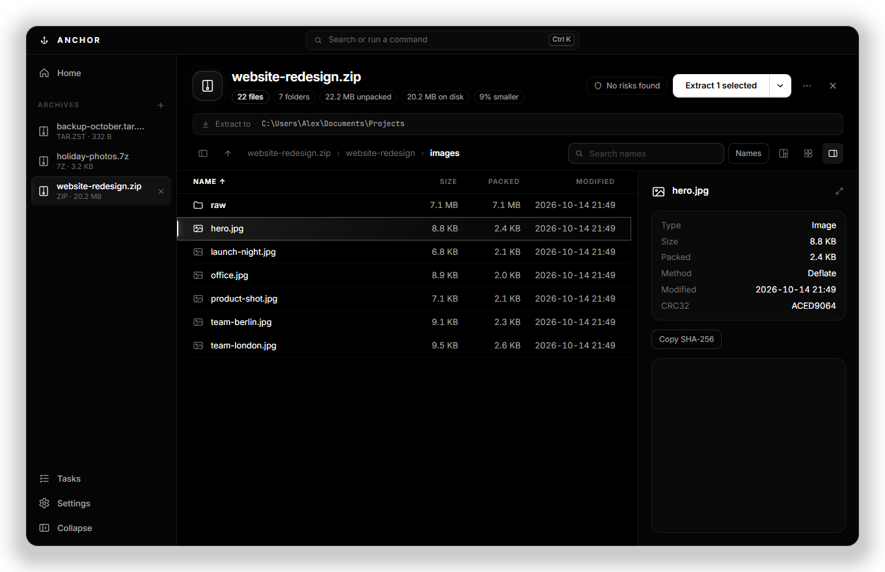

<picture>
<source media="(prefers-color-scheme: dark)" srcset="assets/banner-dark.png">

</picture>

&nbsp;&nbsp;

Free&nbsp;&nbsp;·&nbsp;&nbsp;Windows 10 and 11&nbsp;&nbsp;·&nbsp;&nbsp;x64 and ARM64&nbsp;&nbsp;·&nbsp;&nbsp;No admin rights needed

## What makes it different

<picture>
<source media="(prefers-color-scheme: dark)" srcset="assets/features-dark.png">

</picture>

## Up to 2.6× faster than 7-Zip

Anchor extracts on every processor core at once, so archives with many files finish in well under half the time. With a few large files, the two are even.

<picture>
<source media="(prefers-color-scheme: dark)" srcset="assets/speed-dark.png">

</picture>

See the numbers

| Archive | Anchor | 7-Zip 26.04 | |
| :-- | --: | --: | :-- |
| 4,000 small files · ZIP | 1.43 s | 3.67 s | **2.6× faster** |
| 4,000 small files · TAR.ZST | 1.60 s | 3.98 s | **2.5× faster** |
| 4,000 small files · TAR.GZ | 1.73 s | 3.67 s | **2.1× faster** |
| 4,000 small files · 7Z | 3.69 s | 3.78 s | about the same |
| 8 large files, 320 MB · ZIP | 0.51 s | 0.50 s | about the same |
| 8 large files, 320 MB · 7Z | 0.27 s | 0.26 s | about the same |
| 8 large files, 320 MB · TAR.GZ | 0.76 s | 0.71 s | about the same |
| 8 large files, 320 MB · TAR.ZST | 0.36 s | 0.33 s | about the same |

Measured on one PC with 24 cores, best of three runs, each tool extracting to an empty folder and producing the same files.

## Anchor, 7-Zip and WinRAR

| | **Anchor** | 7-Zip | WinRAR |
| :-- | :--: | :--: | :--: |
| Extracts many small files 2–2.6× faster | ✅ | — | — |
| Opens a ZIP from a link without downloading it all | ✅ | — | — |
| Repairs damaged ZIPs, even without recovery data | ✅ | — | ✅ |
| Recovery data for any archive | ✅ | — | RAR only |
| Size map, with duplicate files found for you | ✅ | — | — |
| Picks the right compression for your files | ✅ | — | — |
| Safety check for disguised programs and zip bombs | ✅ | — | — |
| Undo an extraction | ✅ | — | — |
| Free, with no nag screen | ✅ | ✅ | — |

## See what takes the space

The size map shows an archive by size. Click a folder to go into it. Duplicate files are found by their content, with the space they waste.

## Light or dark, your choice

## Everything it does

<b>Open anything</b>

- Every common format, split archives from any volume, archives inside archives
- Tabs, folder tree, list and grid views, search by name or by text inside files
- Preview images, video, audio, PDF and text without extracting
- Open from a link: paste a ZIP's address (Ctrl+L) and browse it at once

<b>Extract safely</b>

- Uses every processor core, and never puts a folder inside a folder of the same name
- Files appear only when everything succeeded, and Undo takes them back
- Checks free space first, asks before overwriting, keeps Windows' "downloaded from the internet" protection
- Right-click any archive in Explorer: Extract here, Extract to folder, Open with Anchor

<b>Create archives</b>

- ZIP, 7Z, TAR.ZST and TAR.GZ, with AES-256 passwords, split volumes and hidden file names
- Auto compression: photos and video are stored in seconds instead of crunched for minutes
- Recovery data: add 5–20% repair data so damage can be fixed later

<b>Fix and check</b>

- Repair from recovery data, or rebuild a broken or cut-off ZIP from whatever is still readable
- Test integrity, SHA-256 checksums, compare an archive with a folder or another archive
- Safety check flags disguised programs (`invoice.pdf.exe`), paths that escape the folder, and decompression bombs

## Install

1. Open the **[latest release](https://github.com/realhenners/anchor-releases/releases/latest)** and download `Anchor-Setup-<version>.exe`. On a Snapdragon or other ARM PC, take the file ending in `-arm64.exe`.
2. Run it and pick your options.
3. Done. Anchor checks for updates when it starts and installs them in one click.

> [!NOTE]
> **"Windows protected your PC"?** The installer is not code-signed yet, so Windows does not recognise it. Click **More info**, then **Run anyway**.

To remove Anchor: **Settings › Apps › Installed apps › Anchor › Uninstall**.

## Privacy

Anchor works offline. It goes online only to check this page for a new version when it starts (you can switch that off in Settings) and to fetch archives you open from a link. No accounts, no tracking, no telemetry.

## Help

Found a bug or have an idea? **[Open an issue](https://github.com/realhenners/anchor-releases/issues)**. A screenshot and the archive type help a lot.

## Licence

Anchor is free to use at home and at work, and closed source: © 2026 realhenners, all rights reserved. See the [licence agreement](LICENSE.txt).

Anchor includes [7-Zip](https://www.7-zip.org) (GNU LGPL), [par2cmdline](https://github.com/Parchive/par2cmdline) (GNU GPL 2.0), [Electron](https://www.electronjs.org) (MIT) and the Inter and JetBrains Mono typefaces (SIL OFL), each under its own licence. They are listed in the app under Settings › About & licences.
