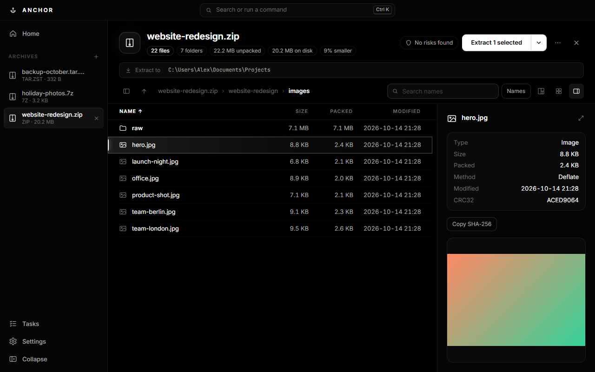
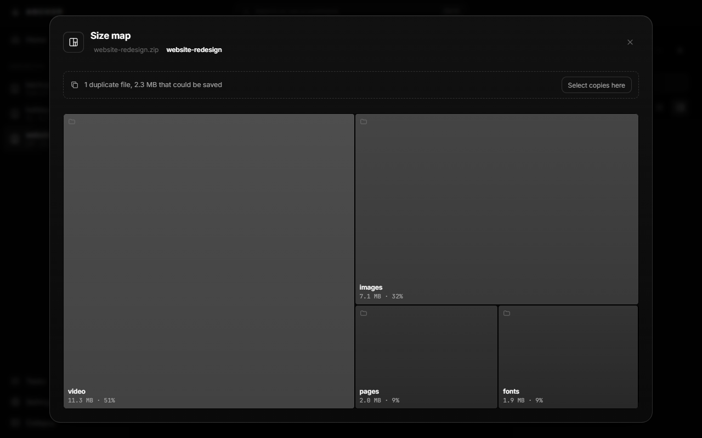
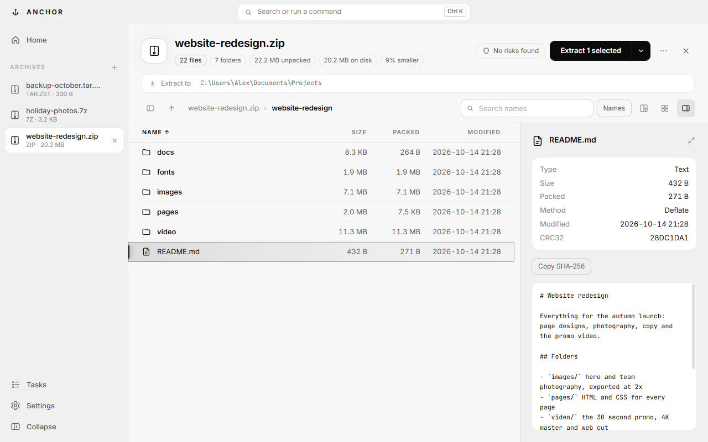

# Anchor

**The archive tool for Windows that opens anything, extracts faster, and fixes what is broken.**

ZIP · 7Z · RAR · TAR · GZ · ZST · ISO and more · Free

### [⬇ Download the latest version](https://github.com/realhenners/anchor-releases/releases/latest)

Windows 10 and 11 · x64 and ARM64 · No admin rights needed

 

---

## Why Anchor

|                                                    | Anchor | 7-Zip | WinRAR |
| -------------------------------------------------- | :----: | :---: | :----: |
| Extracts many small files 2–2.6× faster            | ✓      |       |        |
| Opens a ZIP from a link without downloading it all | ✓      |       |        |
| Repairs damaged ZIPs, even without recovery data   | ✓      |       | ✓      |
| Recovery data for any archive                      | ✓      |       | RAR only |
| Size map with duplicate files found for you        | ✓      |       |        |
| Picks the right compression for your files         | ✓      |       |        |
| Safety check for disguised programs and zip bombs  | ✓      |       |        |
| Undo an extraction                                 | ✓      |       |        |
| Free, no nag screen                                | ✓      | ✓     |        |

## See what takes the space

The size map shows an archive's contents by size. Click a folder to go into it. Duplicate files are found by content, with the space they waste.

## Light or dark

## Features

**Open anything**
- Every common format, split archives from any volume, archives inside archives
- Tabs, folder tree, list and grid views, search by name or by text inside files
- Preview images, video, audio, PDF and text without extracting
- **Open from a link**: paste a ZIP's address (Ctrl+L) and browse it at once. Only the files you open are downloaded

**Extract safely**
- Uses every processor core, and never puts a folder inside a folder of the same name
- Files appear only when everything succeeded, and **Undo** takes them back
- Checks free space first, asks before overwriting, keeps Windows' "downloaded from the internet" protection on files
- Right-click any archive in Explorer: *Extract here*, *Extract to folder*, *Open with Anchor*

**Create archives**
- ZIP, 7Z, TAR.ZST and TAR.GZ, with AES-256 passwords, split volumes and hidden file names
- **Auto compression** looks at your files: photos and video are stored in seconds instead of crunched for minutes
- **Recovery data**: add 5–20% repair data so damage can be fixed later

**Fix and check**
- **Repair** from recovery data, or rebuild a broken or cut-off ZIP from whatever is still readable
- Test integrity, SHA-256 checksums, compare an archive with a folder or with another archive
- Safety check flags disguised programs (`invoice.pdf.exe`), paths that escape the folder, and decompression bombs

## Speed

Extraction time against 7-Zip 26.04 on the same PC, same files out:

| Archive                    | Anchor | 7-Zip  |                 |
| -------------------------- | -----: | -----: | --------------- |
| 4,000 small files, ZIP     | 1.4 s  | 3.7 s  | **2.6× faster** |
| 4,000 small files, TAR.ZST | 1.6 s  | 4.0 s  | **2.5× faster** |
| 4,000 small files, TAR.GZ  | 1.7 s  | 3.7 s  | **2.1× faster** |
| 320 MB in 8 large files    | 0.3–0.8 s | 0.3–0.7 s | about the same |

## Install

1. Open the [latest release](https://github.com/realhenners/anchor-releases/releases/latest) and download **Anchor-Setup-*version*.exe**.
   On a Snapdragon or other ARM PC, take the file ending in **-arm64.exe**.
2. Run it and choose your options.
3. That's it. Anchor checks for updates when it starts and installs them with one click.

> **"Windows protected your PC"?** The installer is not code-signed yet, so Windows does not recognise it. Click **More info**, then **Run anyway**.

To remove Anchor: **Settings › Apps › Installed apps › Anchor › Uninstall**.

## Privacy

Anchor works offline. It goes online only to check this page for a new version when it starts (you can turn that off in Settings) and to fetch archives you open from a link. No accounts, no tracking, no telemetry.

## Help

Found a bug or have an idea? [Open an issue](https://github.com/realhenners/anchor-releases/issues). A screenshot and the archive type help a lot.

## Licence

Anchor is free to use at home and at work. It is closed source: © 2026 realhenners, all rights reserved. See the [licence agreement](LICENSE.txt).

Anchor includes [7-Zip](https://www.7-zip.org) (GNU LGPL), [par2cmdline](https://github.com/Parchive/par2cmdline) (GNU GPL 2.0), [Electron](https://www.electronjs.org) (MIT) and the Inter and JetBrains Mono typefaces (SIL OFL), each under its own licence, listed in the app under **Settings › About & licences**.
